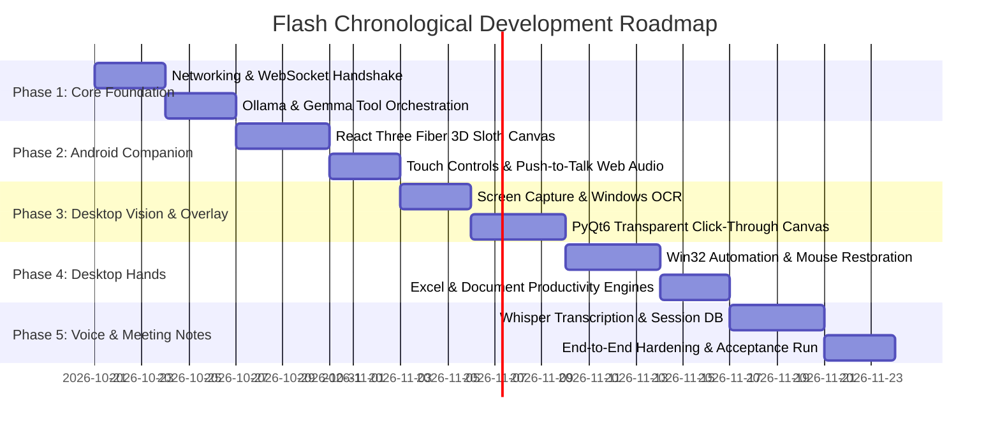

# Flash Implementation Plan: Ordered Milestones & Windows Setup

This implementation plan outlines the chronological development milestones and exact Windows PowerShell commands to build and run Flash.

---

## 1. Prerequisites & Windows Development Environment

### 1.1 Hardware & OS Verification
- **Host Workstation**: Windows 10/11 x64, 16GB+ RAM (8GB minimum with `gemma2:2b`), optional NVIDIA GPU with CUDA.
- **Companion Hardware**: Redmi Android phone with modern Chrome / Firefox browser, connected to the same local Wi-Fi router.

### 1.2 Required Software Checklist
1. **Python 3.11+**: Check with `python --version`
2. **Node.js 20+ & npm**: Check with `node -v` and `npm -v`
3. **Ollama for Windows**: Download from `https://ollama.com/download`
4. **Git**: Check with `git --version`

---

## 2. Exact Windows Setup Commands

Run these commands in Windows PowerShell:

### Step 1: Clone/Set Up Directory Structure
```powershell
# Open working folder
cd C:\Keerthu\flash

# Initialize flash project folders
mkdir -p flash\server
mkdir -p flash\client
mkdir -p flash\assets
mkdir -p flash\docs
```

### Step 2: Set Up Python Backend Virtual Environment
```powershell
# Navigate to server
cd C:\Keerthu\flash\flash\server

# Create virtual environment
python -m venv venv

# Activate virtual environment
.\venv\Scripts\Activate.ps1

# Upgrade pip
python -m pip install --upgrade pip

# Install server dependencies
pip install fastapi uvicorn[standard] websockets pydantic requests
pip install pywin32 pyautogui pywinauto uiautomation mss
pip install winsdk pillow opencv-python numpy
pip install openpyxl python-docx duckduckgo-search
pip install pystray pyinstaller
pip install faster-whisper zeroconf qrcode[pil]

# Optional for GPU acceleration:
# pip install torch torchvision --index-url https://download.pytorch.org/whl/cu121
```

### Step 3: Install & Verify Ollama with Gemma
```powershell
# Verify Ollama is running (starts automatically on Windows as background service)
curl http://localhost:11434/api/tags

# Pull the Gemma 2 model
ollama pull gemma2:9b

# For systems with 8GB RAM or integrated Intel/AMD graphics, pull the 2B model:
ollama pull gemma2:2b

# Verify model response
ollama run gemma2:9b "Hello Flash, are you ready to automate Windows?"
```

### Step 4: Initialize the React TypeScript PWA Client
```powershell
# Navigate to client folder
cd C:\Keerthu\flash\flash\client

# Initialize Vite React + TypeScript template
npm create vite@latest . -- --template react-ts

# Install client packages
npm install
npm install three @types/three @react-three/fiber @react-three/drei
npm install lucide-react clsx tailwindcss @tailwindcss/vite
npm install canvas-confetti @types/canvas-confetti
```

---

## 3. Ordered Implementation Milestones



### Milestone 1: Local Network Bridge & Protocol Handshake (Days 1–3)
- **Deliverables**:
  - `server/app.py`: FastAPI server running on `0.0.0.0:8765`.
  - `server/networking/ws_manager.py`: WebSocket connection manager with heartbeat and token authorization.
  - `server/networking/qr_generator.py`: Generates pairing QR code in console and desktop notification.
  - `client/src/connection/FlashLink.ts`: Browser WebSocket client with auto-reconnection and state store.
- **Validation**:
  - Redmi phone scans laptop QR code; phone connects instantly; bi-directional JSON ping/pong round trip < 20ms.

### Milestone 2: Ollama & Gemma Local AI Orchestrator (Days 4–6)
- **Deliverables**:
  - `server/ai/ollama_client.py`: Async streaming client for Ollama API (`localhost:11434`).
  - `server/ai/gemma_orchestrator.py`: Implements system instructions, function schemas, and multi-turn tool loops.
- **Validation**:
  - Unit test dispatches natural language queries to Gemma; model correctly returns tool invocations (`look_at_screen`, `point_at`, `click`) in valid JSON.

### Milestone 3: 3D Animated Sloth on Android (Days 7–10)
- **Deliverables**:
  - `client/src/character/SlothCanvas.tsx` & `SlothModel.tsx`: 3D Sloth rendered in React Three Fiber.
  - `client/src/character/FaceAnimator.ts`: Damped spring physics engine driving gaze direction, blinking, saccades, ear twitches, and mood expressions.
- **Validation**:
  - Sloth renders smoothly at 60 FPS on Redmi Chrome browser; gaze coordinates broadcast from laptop shift the sloth's eyes and head in real time.

### Milestone 4: Mobile Audio Capture & Web Audio Chirp Synth (Days 11–13)
- **Deliverables**:
  - `client/src/voice/MicStreamer.ts`: Press-and-hold push-to-talk with Web Audio API.
  - `client/src/voice/ChirpSynth.ts`: Procedural C-major pentatonic frequency synthesizer generating soft sloth vocalizations.
- **Validation**:
  - Double tapping screen toggles wake/sleep with chirps; holding screen captures audio; releasing dispatches buffer to backend.

### Milestone 5: Screen Vision, OCR & Control Inspector (Days 14–16)
- **Deliverables**:
  - `server/automation/screen_reader.py`: Fast screen capture via `mss` with Windows Media OCR coordinate mapping.
  - `server/automation/controls_reader.py`: UIAutomation COM tree walker extracting buttons, inputs, links, and checking `IsPassword`.
- **Validation**:
  - Captures 1080p desktop in under 35ms; correctly lists UI targets (`C1..`, `L1..`, `W1..`) with 0–1000 normalized grid coordinates.

### Milestone 6: Transparent Desktop Overlay & Speech Clouds (Days 17–20)
- **Deliverables**:
  - `server/overlay/window.py`: Frameless transparent click-through window using PyQt6 with `WS_EX_LAYERED | WS_EX_TRANSPARENT`.
  - `server/overlay/cursor_engine.py`: Cubic bezier flight paths, comet trails, landing ripples, and click squish animations.
  - `server/overlay/speech_bubble.py`: Floating cloud bubble with auto-wrapping text, spring entrance, and auto-dismiss timer.
- **Validation**:
  - Character cursor flies smoothly across multi-monitor setups; speech bubble positions above target; all mouse clicks click through to native desktop apps underneath.

### Milestone 7: Desktop Automation Hands & Safety Guardrails (Days 21–24)
- **Deliverables**:
  - `server/automation/mouse_driver.py`: Click, drag, and scroll with cursor warp restoration (`GetCursorPos` -> `SendInput` -> `SetCursorPos`).
  - `server/automation/keyboard_driver.py`: Paced unicode text typing and shortcut parser.
  - `server/automation/safety.py`: Global emergency stop hotkey (`Ctrl+Alt+S`), password field refusal, and confirmation prompts.
- **Validation**:
  - "Click Start Menu and type Notepad": Flash flies cursor, clicks Start, types Notepad, presses Enter, and restores user mouse to original spot.

### Milestone 8: Real Excel & Document Productivity Engines (Days 25–27)
- **Deliverables**:
  - `server/ai/tools/excel_tools.py`: Real `.xlsx` generator using `openpyxl` with formatting, headers, and calculating formulas.
  - `server/ai/tools/document_tools.py`: Word `.docx` and markdown document generator using `python-docx`.
- **Validation**:
  - "Create an expense report for my business trip": Flash creates formatted `expenses.xlsx` with working `=SUM()` formulas and opens it in Excel.

### Milestone 9: Meeting Notes, Local STT & Session Persistence (Days 28–31)
- **Deliverables**:
  - `server/audio/stt_engine.py`: Local transcription via `faster-whisper`.
  - `server/storage/notes_writer.py`: Generates timestamped notes files in `%USERPROFILE%\Documents\Flash Notes\<date> <id>\notes.md`.
  - `client/src/views/SessionsView.tsx`: Mobile session history viewer with "Copy prompt for agent" button.
- **Validation**:
  - Runs continuous 10-minute session; creates audio chunks and timestamped `notes.md`; phone displays transcript and copies valid agent prompt.

### Milestone 10: End-to-End Hardening & User Acceptance Run (Days 32–34)
- **Deliverables**:
  - Full system integration testing on Windows 10/11 laptop + Redmi phone.
  - Packaging with PyInstaller (`flash-agent.exe`) and PWA offline manifest caching.
- **Validation**:
  - Complete user test scenario: Wake Flash -> Voice command "Research current AI news and make a summary spreadsheet" -> Flash researches, shows report card, creates Excel workbook, opens it, and points to the summary.

---

## 4. How to Run Locally

### Terminal 1: Ollama Server
```powershell
ollama serve
```

### Terminal 2: Windows Python Agent
```powershell
cd C:\Keerthu\flash\flash\server
.\venv\Scripts\Activate.ps1
python app.py
```

### Terminal 3: React Phone Client Dev Server
```powershell
cd C:\Keerthu\flash\flash\client
npm run dev -- --host
```
*Open the displayed Network URL (e.g., `http://192.168.1.15:5173`) on your Redmi phone browser.*
